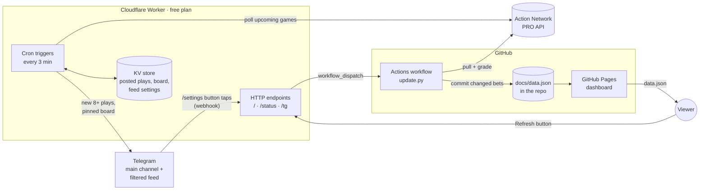

# Sharp Move Tracker

A serverless system that tracks how "sharp money" bets actually perform. It pulls professional
betting signals from Action Network PRO across six leagues (NFL, NCAAF, NBA, NCAAB, NHL, MLB),
grades every play once its game ends, publishes the record on a public dashboard, and pushes
near-real-time alerts to Telegram channels.

**Live dashboard:** https://justinyang597.github.io/sharp-tracker/

## The problem

Action Network PRO labels bets with "sharp moves": a count of **steam moves** (sudden, market-wide
line moves caused by professional bettors) plus **reverse line moves** (the line moving *against*
the side most of the public is betting). The app shows the signal but not whether it wins.
This project answers that question: **does a higher sharp-move count actually predict winning
bets?** It logs every play with 5+ sharp moves, grades it against the final score, and breaks
the record down by move count, sport and bet type. It has logged and graded 6,000+ plays so far.

## Architecture



There are two independent pipelines that share one data source.

### 1. The tracker: API → `data.json` → website (GitHub Actions + Pages)

1. **Trigger.** A viewer presses **Refresh** on the site. The page calls the Cloudflare Worker,
   which starts the `update.yml` workflow through the GitHub API. The Worker holds the GitHub
   token, so the static site never sees it. If a run is already going or started in the last
   90 seconds, the Worker just reports "running" instead of queuing duplicates.
2. **Collect.** [`update.py`](update.py) (Python standard library only) checks the login against
   the account endpoint, then requests each league's PRO report for the last 3 days through
   tomorrow. Football is fetched by week, because that endpoint ignores dates.
3. **Normalize.** For every game, it reads each market (spread, total, moneyline) and side, keeps
   the `sharp_money` signals with `steam + reverse ≥ 5`, and attaches the line and odds from the
   consensus book (falling back to DraftKings, then FanDuel). Each play gets a stable ID,
   `league-gameId-market-side`, so re-pulling the same game updates its row in place.
4. **Grade.** Finished games are graded W/L/P from the final score against the logged line.
   Plays whose signal later dropped below 5 still get graded, because the script also records
   the state of every game it pulled, not just the games with qualifying plays.
5. **Store.** `docs/data.json` is the database: one play per line, sorted by start time. The
   workflow commits only when a play actually changed. The "updated" timestamp on line 1 is
   excluded from the diff (`git diff -I`), so the history isn't flooded with no-op commits.
6. **Publish.** The `docs/` folder is uploaded and deployed to GitHub Pages.
   [`docs/index.html`](docs/index.html) is a single-file, dependency-free web app (vanilla
   JS, mobile-first). It loads `data.json` and computes everything client-side: win rate and
   units by move count, sport and bet type, plus filters, date ranges and sorting.

### 2. The alerts: Telegram bot (Cloudflare Worker)

[`worker/worker.js`](worker/worker.js) runs on cron triggers and checks upcoming games every
3 minutes:

- **Main channel:** posts each play the first time it reaches **8+** sharp moves, grouped by day
  and sorted by start time. It also keeps one **pinned board** message, edited in place, that
  lists every upcoming 8+ play.
- **Filtered feed:** a second channel that only gets plays matching an admin-chosen filter (for
  example, college football at 13+). Admins change the filter with inline buttons in a private
  chat with the bot. Telegram delivers those taps to the Worker's `/tg` webhook.

## Design decisions

**Why a Cloudflare Worker *and* GitHub Actions?** They solve different problems.
- *GitHub Actions* is good at a full rebuild: pulling five days across six leagues, grading,
  committing, deploying. But a run takes a minute or more and GitHub's scheduler is often late
  by many minutes, which is too slow for alerts.
- *A Worker* starts in milliseconds, runs on exact cron timing, and can hold secrets, which makes
  it the right place for frequent polling and for the Refresh button's backend.

**Working within free-plan limits.**
- *CPU time.* A free Worker gets about 10 ms of CPU per invocation. Checking all six leagues in
  one run wouldn't fit, so the leagues are split across three crons offset by a minute:
  - `*/3` football
  - `1-59/3` NBA / NHL / MLB
  - `2-59/3` college basketball

  Each sport is still checked every 3 minutes.
- *KV writes.* Workers KV allows about 1,000 writes a day on the free plan, so the Worker writes
  only when something changes: a new play, the board's play list, or a settings tap. The board
  also gets a refresh every 30 minutes so counts stay current, and status is written hourly.
- *Actions minutes.* Updates run on demand (the Refresh button) instead of on a timer.

**Never posting the same alert twice.** Each channel has its own KV record that maps play ID to
an expiry (game start + 2 days). A play is posted only if its ID isn't in that record, and the
record is saved right after posting. Plays are also de-duplicated by ID within a check, because
two date queries can return the same late-night game. Expired IDs are pruned on each run.

**Catching late money.** Sharp action often lands at tip-off, after the last check before the
listed start. Games that the API still shows as not started stay eligible for 20 minutes past
their listed start time, and those posts are marked "starting now".

**No false "login expired" alarms.** A single failed request or a slate with thin PRO coverage
can look like a logged-out session. Before warning the channel, the Worker confirms with the
account endpoint and requires two confirmed failures at least 4 minutes apart. After that it
warns at most once a day.

**Resilient deploys.** GitHub Pages sometimes can't find a just-uploaded artifact ("No
artifacts named github-pages"). The deploy step retries twice with a backoff instead of failing
the run.

**Security.**
- Every credential (Action Network session, GitHub token, Telegram bot token) lives in
  GitHub Actions secrets or Cloudflare secrets, never in the repo.
- The GitHub token is fine-grained, scoped to this one repository and to Actions only.
- The Telegram webhook only accepts requests carrying a secret derived from the bot token.
- Only allow-listed Telegram user IDs can change the feed settings.

**Grading at the closing line.** Plays are graded at the consensus line just before the game,
not the earlier number the sharps themselves got. So the record measures what a follower who
bets late would get, which is the realistic case for anyone acting on these signals.

## Data model

Each row in `docs/data.json`:

| Field | Meaning |
|---|---|
| `id` | `league-gameId-market-side`, the unique key used for upserts and alert dedup |
| `lg`, `d`, `t` | league, game date (YYYYMMDD), start time (ISO) |
| `a`, `h` | away and home team |
| `m`, `s`, `pick` | market (`spread` / `total` / `moneyline`), side, readable pick |
| `line`, `odds`, `book` | closing line and odds, and which book they came from |
| `steam`, `rlm`, `str` | steam moves, reverse line moves, signal strength |
| `as`, `hs`, `st` | away score, home score, game status |
| `r` | result: `W`, `L`, `P` (push), or empty until graded |

## Repository layout

| Path | What it is |
|---|---|
| [`update.py`](update.py) | Collector and grader: pulls the API, grades, writes `docs/data.json` |
| [`.github/workflows/update.yml`](.github/workflows/update.yml) | On-demand update: run, commit if changed, deploy Pages with retries |
| [`.github/workflows/check-token.yml`](.github/workflows/check-token.yml) | Daily login check; fails (and emails) if the session expired |
| [`docs/`](docs) | The dashboard (`index.html`) and its data (`data.json`) |
| [`worker/`](worker) | Cloudflare Worker: Refresh relay, Telegram alerts, feed settings ([setup](worker/README.md)) |
| `collector.js`, `receiver.py`, `build.py` | **Version 1, kept for reference.** A browser-console collector that posted rows to a local server, so it only ran while my PC was on. It was replaced by the cloud pipeline above. |

## Limitations

- Action Network's login requires a captcha, so it can't be automated. The session token
  (about 6 months) has to be refreshed by hand. The daily check and the site's warning banner
  make that visible before it causes gaps.
- The history depends on what the PRO report returns for past dates. Plays are recorded as of
  the time they were pulled.
- This is a personal analytics project, not betting advice.

## Operations

### Refreshing the Action Network token

The updater signs in with an existing Action Network browser session, not a password. When the
session expires, the check workflow fails and GitHub emails the repo owner. To refresh it:

1. In Chrome, go to https://www.actionnetwork.com and make sure you're signed in.
2. Press F12 to open DevTools, then go to **Application** → **Cookies** →
   `https://www.actionnetwork.com`.
3. Find the cookie named `AN_SESSION_TOKEN_V1` and copy its **Value**.
4. In this repo on GitHub: **Settings** → **Secrets and variables** → **Actions** →
   `AN_TOKEN` → **Update**, paste the value, and save.
5. Also paste it into the Cloudflare Worker: **Settings** → **Variables and Secrets** → `AN_TOKEN`
   → edit → **Deploy**.
6. **Actions** tab → **Update sharp tracker** → **Run workflow** to confirm it works.

Treat that value like a password. Signing out of Action Network ends the session, so the secret
has to be refreshed after that.

### Running locally

```bash
AN_TOKEN=... python update.py                     # last 3 days through tomorrow
AN_TOKEN=... python update.py 20261001 20261010   # a specific date range
AN_TOKEN=... python update.py --check             # only confirm the login works
```
